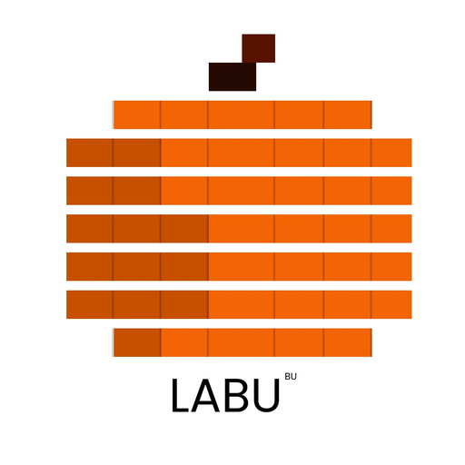

<p align="center">
  
</p>

<h1 align="center">LABU — Kindle Book Algoritma</h1>

Aplikasi web progresif (PWA) untuk belajar **Analisis dan Desain Algoritma** dalam Bahasa Indonesia. LABU menggabungkan materi bacaan, visualisasi langkah demi langkah, kuis, dan tantangan kode dalam satu aplikasi yang bisa dipakai offline.

## Deploy

Aplikasi sudah dideploy dan dapat dibuka di: https://magentakey.github.io/labu-kindle-book-algoritma/

LABU adalah PWA, jadi bisa **diunduh dan dipasang** ke perangkat. Buka alamat di atas lewat Chrome atau Edge lalu pilih ikon pasang di bilah alamat, atau di Android pilih menu ⋮ → *Instal aplikasi* / *Tambahkan ke layar utama*. Setelah terpasang, aplikasi tetap bisa dipakai tanpa internet.

## Tim

| Nama | Peran |
| --- | --- |
| Ramdhany Sunarto | Programmer |
| Muhammad Andi Rizky Maulana Ibrahim | Analyst |
| Iqbal Andrianto | Project Manager & Designer |
| Gilang Putra Wardana | Documenter |

## Desain

Antarmuka mengikuti desain dan style guide dari tim desain di Figma: [LABU^BU di Figma](https://www.figma.com/design/3TT4J1eJnSFqfh2sm285g2/LABU%5EBU?node-id=4-77&t=c4q5ifDOBHIhtbIw-1).

## Fitur

- **24 modul materi** dengan rumus (MathJax), pseudocode, dan komponen interaktif.
- **Visualizer algoritma** untuk pencarian, sorting, analisis, DP, greedy, penelusuran graf, MST, dan shortest path. Setiap langkah menunjukkan baris pseudocode, nilai variabel, dan gambar (batang, graf, tabel, garis waktu, pohon Huffman).
- **Bandingkan dua algoritma** secara berdampingan dengan data yang sama, langkah serempak, hitungan operasi, dan kesimpulan otomatis. Pasangan yang tersedia:
  - Insertion Sort vs Merge Sort
  - BFS vs DFS
  - Kruskal vs Prim
  - Dijkstra vs Bellman-Ford
- **Kuis pilihan ganda** di setiap modul (jawaban tunggal dan banyak jawaban), dengan koreksi langsung, bunyi umpan balik, dan rincian hasil.
- **Mode tantangan kode** di 21 modul: tulis fungsi JavaScript di editor (CodeMirror), jalankan terhadap kasus uji, lalu bandingkan dengan solusi.
- **PWA**: dapat diunduh, dipasang, dan dipakai offline.
- **Aksesibilitas**: mengikuti WCAG 2.x level AA, mendukung mode terang dan gelap, dan diaudit otomatis dengan axe-core.

## Teknologi

React 19, Vite, Tailwind CSS 4, React Router 7, react-markdown (remark-gfm, remark-math), MathJax, CodeMirror 6, vite-plugin-pwa. Pengujian memakai test runner bawaan Node (`node --test`).

## Install Lokal

Prasyarat: Node.js 20 atau lebih baru.

```bash
git clone https://github.com/Magentakey/labu-kindle-book-algoritma.git
cd labu-kindle-book-algoritma
npm install
npm run dev
```

Buka alamat yang ditampilkan di terminal (biasanya `http://localhost:5173/labu-kindle-book-algoritma/`).

Untuk mencoba hasil build seperti versi deploy:

```bash
npm run build
npm run preview
```

## Unit test

Proyek memiliki lebih dari 1.200 unit test yang dijalankan dengan test runner bawaan Node, tanpa framework tambahan:

```bash
npm test
```

Cakupannya:

- **Algoritma dan trace visualizer:** kebenaran tiap langkah (BFS, DFS, Kruskal, Prim, Dijkstra, Bellman-Ford, DP, greedy, dan lainnya) serta model Bandingkan.
- **Konten modul:** struktur materi, kunci dan pembahasan kuis di seluruh 24 modul, dan kasus uji tantangan kode (solusi harus lolos semua kasus, kode awal tidak boleh lolos).
- **Mesin kuis, antarmuka, dan PWA:** penilaian, status komponen, tema, dan render halaman.

Tes tertentu dapat dijalankan sendiri, misalnya `node --test src/viz/stagesModel.test.js`. `npm run lint` dan `npm run audit:a11y` melengkapi tes dengan pemeriksaan kode dan aksesibilitas.

## Perintah

| Perintah | Fungsi |
| --- | --- |
| `npm run dev` | Server pengembangan dengan HMR |
| `npm run build` | Build produksi ke `dist/` |
| `npm run preview` | Menjalankan hasil build secara lokal |
| `npm run lint` | ESLint (termasuk aturan jsx-a11y) |
| `npm test` | Seluruh pengujian unit dan konten |
| `npm run check:content` | Memeriksa kelengkapan konten modul |
| `npm run audit:a11y` | Audit aksesibilitas axe-core di Chromium (mode terang dan gelap) |

Audit aksesibilitas membutuhkan server preview yang berjalan dan Chromium:

```bash
npm run build
npx vite preview --port 4173      # terminal 1
npm run audit:a11y                # terminal 2
```

Opsi lewat variabel lingkungan: `AUDIT_URL`, `AUDIT_ONLY` (potongan nama rute), `AUDIT_TEMA` (`light` atau `dark`), `CHROMIUM_PATH`.

## Struktur proyek

```
src/
  content/modul/   Materi tiap modul: NN.md, NN.kuis.js, NN.tantangan.json, NN.pseudo.js
  algorithms/      Trace langkah demi langkah tiap algoritma (traces/)
  viz/             Model dan komponen visualizer, Bandingkan, pemutar
  pages/           Halaman: Algoritma, AlgoritmaDetail, Bandingkan, Materi, Kuis
  lib/             Mesin kuis dan utilitas
  ui/              Komponen antarmuka bersama
  pwa/             Service worker dan pembaruan aplikasi
docs/              Panduan menulis materi, soal, rumus, visualizer, dan pengujian
scripts/           Pemeriksa konten dan audit aksesibilitas
```

## Menambah konten

Panduan lengkap ada di folder [`docs/`](docs):

- [`menambah-modul.md`](docs/menambah-modul.md): langkah menambah modul baru
- [`panduan-menulis-materi.md`](docs/panduan-menulis-materi.md) dan [`template-materi.md`](docs/template-materi.md)
- [`panduan-menulis-soal.md`](docs/panduan-menulis-soal.md): format kuis
- [`panduan-rumus.md`](docs/panduan-rumus.md)
- [`panduan-komponen-interaktif.md`](docs/panduan-komponen-interaktif.md)
- [`pengujian-dan-aksesibilitas.md`](docs/pengujian-dan-aksesibilitas.md)

Format singkat tantangan kode (`NN.tantangan.json`): `id`, `title`, `description`, `starterCode`, `solution`, dan `testCases` berisi `input` (daftar argumen) dan `expected`. Kode pengguna dijalankan sebagai `solve(...input)`. Tempatkan slot `{{tantangan}}` di berkas `.md` modul sebelum bagian kesimpulan dan daftarkan di `src/content/modul/index.js`.

## Kontribusi

1. Buat cabang baru dari `main`.
2. Pastikan `npm run lint` dan `npm test` lulus, dan jalankan `npm run audit:a11y` bila mengubah antarmuka.
3. Ajukan pull request dengan deskripsi perubahan yang jelas.

## Catatan

- Audit otomatis tidak menggantikan uji manual dengan pembaca layar, perangkat seluler, dan mode offline.
